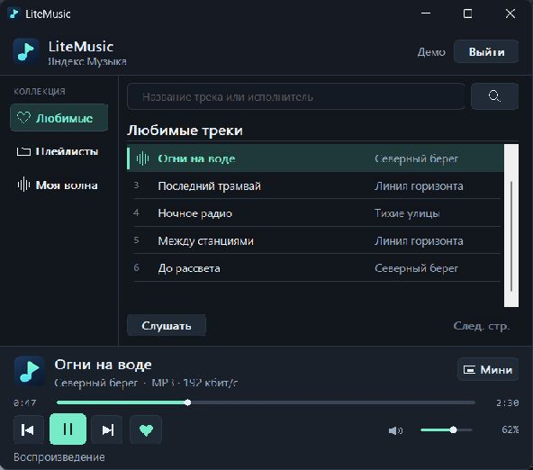
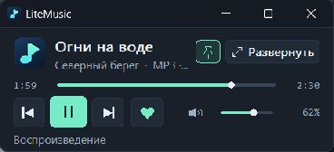

  
  <h1>LiteMusic</h1>
  
<strong>Компактный клиент Яндекс Музыки для Windows, Linux и macOS</strong>

  
Любимые треки, плейлисты, поиск и «Моя волна» в одном приложении.

  

    
    
    
    
    
    
  

  
<a href="https://github.com/artS3rg/LiteMusic/releases/latest/download/LiteMusic.exe"><strong>Скачать .exe</strong></a> · <a href="#запуск">Linux и macOS</a> · <a href="#сборка">Как собрать</a> · <a href="https://github.com/artS3rg/LiteMusic/issues/new">Сообщить об ошибке</a>

## Скриншоты

**Основное окно** с коллекцией, поиском и плеером.

**Мини-плеер** с кнопкой закрепления поверх окон.

*На скриншотах Windows и демонстрационная коллекция.*

> [!NOTE]
> LiteMusic запускается одним файлом `LiteMusic.exe`. Воспроизведение использует Media Foundation, который входит в состав Windows.

> [!TIP]
> Нажмите **Ctrl+M** (**⌘M** на Mac) или кнопку **Мини**, чтобы оставить на экране только плеер. Кнопка закрепления удерживает его поверх других окон, если оконный менеджер это поддерживает.

## Возможности

- Любимые треки, свои и сохранённые плейлисты, поиск по названию или исполнителю.
- «Моя волна» с автоматическим переходом и историей из 32 прослушанных треков в текущем сеансе.
- Лайк текущего трека, перемотка, громкость, пауза и переход между треками. «Предыдущий» переключает трек в первые три секунды. Позже кнопка возвращает к началу.
- Системные кнопки Play/Pause, Next и Previous работают и в свёрнутом окне, когда Windows направляет их сеансу LiteMusic. [Управление медиа Windows](https://learn.microsoft.com/en-us/previous-versions/windows/desktop/mediatransport/isystemmediatransportcontrols)
- После перезапуска плеер показывает последний трек и позицию. Воспроизведение ждёт команды Play. Громкость восстанавливается отдельно.
- У мини-плеера есть кнопка закрепления поверх окон. При возврате к коллекции закрепление снимается, а при повторном открытии мини-плеера применяется снова в рамках текущего запуска.

## Запуск

Первые сборки Linux и macOS можно скачать из [тестового выпуска](https://github.com/artS3rg/LiteMusic/releases/tag/v0.1.0-ports.1). Результат проверки воспроизведения доступен в [GitHub Actions](https://github.com/artS3rg/LiteMusic/actions/runs/43623806075).

| Система | Как запустить |
|---|---|
| Windows 10/11 x64 | Скачайте **LiteMusic.exe** из [выпуска](https://github.com/artS3rg/LiteMusic/releases/latest) и откройте. |
| Linux x86-64 | Для Ubuntu 24.04: `sudo apt install ./LiteMusic-linux-x86_64.deb`. Затем откройте LiteMusic из меню или выполните `LiteMusic`. В `.tar.gz` лежит тот же бинарник для ручной установки; ему нужны совместимые версии системных библиотек и плагины GStreamer из зависимостей `packaging/debian-control`. Графика использует X11 или XWayland. |
| macOS 12+ | Возьмите ZIP **arm64** для Apple Silicon или **x86_64** для Intel. Распакуйте и откройте **LiteMusic.app**. Сборки тестовые: у них нет нотариального заверения Apple. Если macOS заблокирует запуск, откройте **Системные настройки → Конфиденциальность и безопасность → Всё равно открыть**. |

1. Откройте приложение.
2. Нажмите **Войти**. Введите код из LiteMusic на открывшейся странице Яндекса и подтвердите вход.
3. Выберите раздел. Двойной щелчок или Enter запускает выбранный трек. В Windows Ctrl+F переводит фокус в поиск.

OAuth-токен хранится в Диспетчере учётных данных Windows, Связке ключей macOS или Secret Service на Linux. Если хранилище недоступно, вход действует до закрытия приложения. Отдельно сохраняются громкость и позиция трека. Кнопка **Выйти** удаляет сохранённый токен и последний трек. При восстановлении открывается один трек. Для продолжения конкретного плейлиста или «Моей волны» откройте соответствующий раздел.

LiteMusic использует неофициальный API Яндекс Музыки. Вход и каталог зависят от его доступности, а возможность воспроизведения — от аккаунта. Приложение запрашивает поток MP3 стандартного качества.

## Сборка

### Windows

Понадобятся CMake 3.20+, Ninja и MinGW-w64 x64 с поддержкой C++20 и заголовками Windows Media. Добавьте MinGW и Ninja в PATH.

~~~powershell
git clone https://github.com/artS3rg/LiteMusic.git
cd LiteMusic
cmake -S . -B build -G Ninja -DCMAKE_BUILD_TYPE=Release
cmake --build build
~~~

Готовый файл находится в build/LiteMusic.exe. Проверка локального аудио без входа в аккаунт:

~~~powershell
.\build\LiteMusic.exe --audio-test "C:\music\track.mp3"
Start-Process .\build\LiteMusic.exe -ArgumentList '--verify-audio "C:\music\track.wav"' -PassThru -Wait |
    Select-Object ExitCode
~~~

Код 0 означает, что беззвучное воспроизведение достигло 0,5 секунды.

### Linux и macOS

Нужен CMake 3.20+ с компилятором C++20. CMake загрузит FLTK. На Ubuntu 24.04 установите пакеты из шага **Install dependencies** в [сценарии сборки](.github/workflows/portable.yml). На Mac установите Xcode Command Line Tools.

~~~sh
cmake -S . -B build -DCMAKE_BUILD_TYPE=Release
cmake --build build --parallel
~~~

На Linux результат — `build/LiteMusic`, на macOS — `build/LiteMusic.app`. Системные медиаклавиши пока поддерживаются в сборке Windows.

## Расход ресурсов

Ниже один замер раннего прототипа LiteMusic и официального клиента Яндекс Музыки 5.127.0 на Windows 11 с 12 логическими процессорами. В обоих клиентах открывали один трек на примерно 192 кбит/с. LiteMusic воспроизводил MP3, официальный клиент — AAC. Длительность каждого сценария около 31 секунды. Результаты относятся к той сборке прототипа.

| Сценарий | LiteMusic, МиБ / CPU | Яндекс Музыка, МиБ / CPU |
|---|---:|---:|
| Воспроизведение | 9,94 / 0,126% | 847,69 / 7,026% |
| Пауза | 9,86 / 0% | 852,54 / 0,538% |

Для повторного замера откройте один трек в обоих клиентах и дождитесь начала воспроизведения или поставьте оба клиента на паузу. Запустите скрипт для соответствующего сценария:

~~~powershell
.\Measure-LiteMusic.ps1 -Scenario Playing -Seconds 30
.\Measure-LiteMusic.ps1 -Scenario Paused -Seconds 30
~~~

Скрипт суммирует частную память всех процессов каждого клиента и выводит медиану. CPU считается по приросту процессорного времени и нормируется на число логических процессоров. Если имена процессов отличаются, передайте параметры -Prototype и -Official.

## Лицензия

Код LiteMusic распространяется по лицензии [MIT](LICENSE). Встроенный cJSON также использует MIT, его уведомление приведено в [THIRD_PARTY_NOTICES](THIRD_PARTY_NOTICES).

За описание неофициального API спасибо проекту [MarshalX/yandex-music-api](https://github.com/MarshalX/yandex-music-api).
